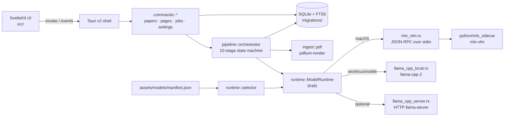
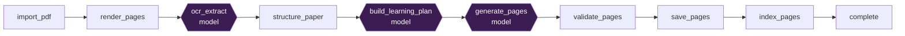
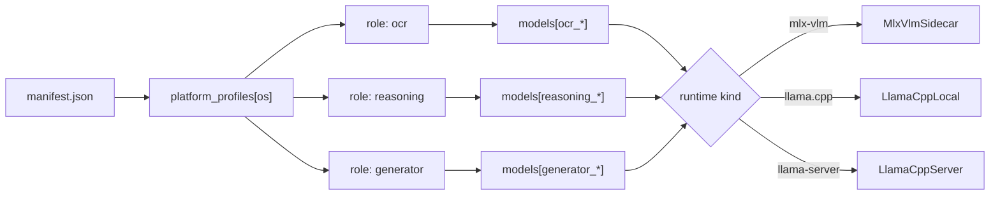

# Smilie Architecture

This is the high-level map of how the parts fit together. Pair it with
[`docs/plans/2026-04-24-smilie-design.md`](plans/2026-04-24-smilie-design.md)
for the design contract and rationale.

## System diagram



## 10-stage pipeline



Stages marked with `{{ }}` call into a `ModelRuntime`; the rest are
pure Rust (PDF rasterization, JSON shaping, SQLite writes, FTS5
indexing). The orchestrator persists the current stage on every
transition so a crashed job resumes from the last failed stage instead
of restarting from scratch.

## Runtime selector flow

`runtime::selector::RuntimeSelector::build` reads
`assets/models/manifest.json`, looks up the current platform key
(`macos` / `windows` / `linux` / `ios` / `android`) in
`platform_profiles`, and resolves the three roles (`ocr`, `reasoning`,
`generator`) against the `models` map.



If a role is unmapped or the file is missing on disk, the runtime is
constructed but its `status()` returns `RuntimeStatus::MissingWeights`.
The pipeline halts cleanly and the Settings → Runtime panel surfaces
the expected path so the user knows what to drop where.

## Block schema

Generator output is a small typed DSL — never raw HTML. The Rust
renderer in `pipeline::render` owns all visual styling, so a model can
mis-style nothing. Quoted from `src-tauri/src/runtime/types.rs`:

```rust
#[derive(Debug, Clone, Serialize, Deserialize)]
#[serde(tag = "type", rename_all = "snake_case")]
pub enum Block {
    Heading    { level: u8, text: String },
    Paragraph  { text: String },
    Callout    { kind: String, title: Option<String>, body: String },
    KeyTerm    { term: String, definition: String },
    Formula    { latex: String, caption: Option<String> },
    List       { items: Vec<String>, ordered: bool },
    Quiz       { questions: Vec<QuizQuestion> },
    DiagramFlow { title: Option<String>,
                  nodes: Vec<DiagramNode>,
                  edges: Vec<DiagramEdge> },
    SourceRef  { section_ids: Vec<String>, page_numbers: Vec<u32> },
    Code       { lang: Option<String>, code: String },
}
```

Adding a block type requires three edits in lockstep: the enum here, a
match arm in `pipeline::render`, and a normalization arm in
`mlx_sidecar/server.py::_normalize_block` so the sidecar doesn't drop
it on the floor.

## File layout

```
Smilie/
├── src/                              SvelteKit frontend (TS)
│   ├── lib/
│   │   ├── components/               Library, PageViewer, Settings, ...
│   │   ├── stores/                   papers, jobs, paper_detail
│   │   ├── ipc/                      typed Tauri invoke wrappers
│   │   ├── theme/                    Night-Tokyo tokens
│   │   └── keyboard/                 shortcut layer
│   └── routes/                       /, /papers/[id], /settings
├── src-tauri/
│   ├── src/
│   │   ├── commands/                 Tauri IPC surface (papers/pages/jobs/...)
│   │   ├── ingest/                   pdfium rendering + structure heuristics
│   │   ├── pipeline/
│   │   │   ├── orchestrator.rs       10-stage state machine
│   │   │   ├── render.rs             Block -> HTML renderer
│   │   │   └── stages/               one file per stage
│   │   ├── runtime/                  ModelRuntime trait + impls + selector
│   │   ├── db/                       sqlx queries
│   │   ├── manifest.rs               manifest.json schema + loader
│   │   ├── srs.rs                    quiz spaced repetition
│   │   └── validation.rs             page-level validators
│   ├── python/mlx_sidecar/           macOS-only mlx-vlm sidecar (JSON-RPC)
│   ├── migrations/                   SQL migrations
│   └── assets/page-sdk.js            injected SDK for generated pages
├── assets/
│   ├── models/{ocr,reasoning,generator}/   weights live here
│   ├── models/manifest.json                runtime wiring
│   └── pdfium/                              libpdfium dylib (per OS)
└── docs/
    ├── architecture.md               this file
    ├── plans/2026-04-24-smilie-design.md   design contract
    ├── mobile.md                     iOS + Android setup
    └── security.md                   CSP rationale
```
